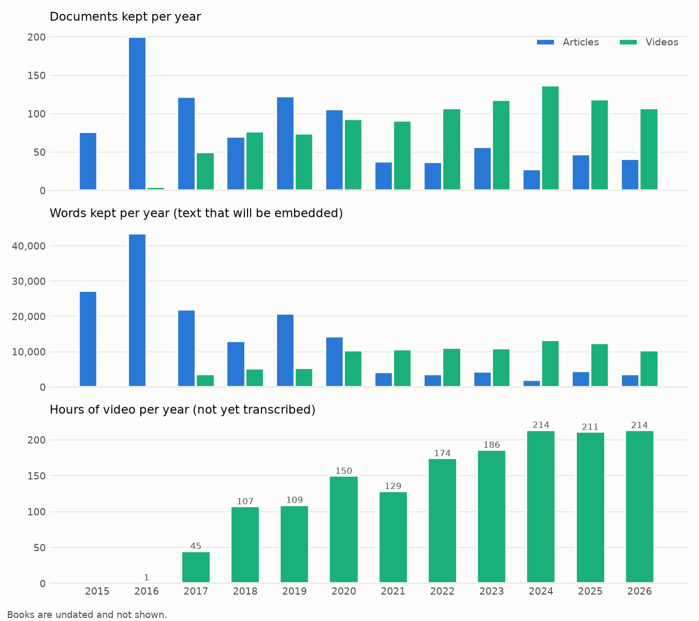

# UrzaLLM – preprocessing report

Generated 2026-11-11 21:09 from `C:\Users\mardo\Desktop\CUM\UrzaLLM\jsons` in 1.24 s. Every raw record appears in `documents.jsonl` with a `status`; nothing is silently dropped.

## 1. Summary

**3,073** raw records went in; **2,036** documents were kept and split into **2,528** chunks ready for embedding. The chunks hold 358,555 words, slightly more than the documents, because a short sentence is repeated where a long document is split.

| Source | Raw records¹ | Kept | Excluded | Words kept | Chunks |
|---|---:|---:|---:|---:|---:|
| Articles | 1,953 | 945 | 1,008 | 163,066 | 956 |
| Books | 142 | 113 | 29 | 98,909 | 592 |
| Videos | 978 | 978 | 0 | 93,919 | 980 |
| **Total** | 3,073 | 2,036 | 1,037 | 355,894 | 2,528 |

¹ For books: sections in the table of contents (after merging aphorisms that share a page).

Things to keep in mind when reading coverage results:

- **Videos are represented by their descriptions only.** 978 videos (1,541 hours of speech) contribute 93,919 words. Their content is much richer than what is embedded here.
- **Text output drops after 2020** while video output grows (see section 8). A timeline of text alone would wrongly suggest Urza went quiet.
- **542 videos have guests.** Their descriptions summarise a conversation, not only Urza's views.
- **Announcements are kept but labelled** (`kind`), so the embedding and coverage steps can filter them out.

## 2. What was removed and why

| Source | Reason | Count | Meaning | Examples |
|---|---|---:|---|---|
| Articles | `duplicate_text` | 3 | Exactly the same raw text as an earlier article (earliest copy kept); posts whose text differs in any way are kept. | Vánoční večírek pro podporovatele Přístavu 2023!; Konference Svobodného přístavu 2024: Technologie včera, dnes a zítra se koná již... pozítří!; Ankap jako globální respekt v čajovně Cherubín podruhé |
| Articles | `no_text_no_title` | 4 | No text and a title without words (e.g. “????”). | ?; ??; 🍕 + 2^2^2 |
| Articles | `video_only` | 1,001 | Post with no text whose body embeds or links a video (field `video` from the scraper); the video itself is kept. | KANÁL SVOBODNÉHO PŘÍSTAVU: Ankap přednáška o nemorálním státu; KANÁL SVOBODNÉHO PŘÍSTAVU: Řídit stát jako firmu?; KANÁL SVOBODNÉHO PŘÍSTAVU: Zákaz kouření |
| Books | `back_matter` | 11 | After the main text: partner organisations and adverts (ankap “Nakloněni svobodě”, “Jiná cesta…”), sponsors, colophon. | Nakloněni svobodě; Kdo jsme?; Jiná cesta... |
| Books | `front_matter` | 8 | Before the main text: blurb, about the author, title page, dedication and epigraph, acknowledgements, contents, ISBN. | O knize; O autorovi; Věnování |
| Books | `heading_only` | 10 | A heading that only groups subsections (e.g. “AMEN › Ekonomie”); its subsections are kept. | Tři příběhy; dodatek; Další oblasti státního vlivu |

### Duplicate articles

| Removed | Date | Same text as | Date |
|---|---|---|---|
| Vánoční večírek pro podporovatele Přístavu 2023! | 2023-12-04 | Vánoční večírek pro podporovatele Přístavu! | 2019-12-18 |
| Konference Svobodného přístavu 2024: Technologie včera, dnes a zítra se koná již... pozítří! | 2024-02-22 | Konference Svobodného přístavu 2023: Drogy a zbraně včera, dnes a zítra se koná již... zítra! | 2023-02-17 |
| Ankap jako globální respekt v čajovně Cherubín podruhé | 2024-03-05 | Ankap jako globální respekt v čajovně Cherubín | 2023-12-05 |

## 3. What was kept

Each kept document has a `kind`. Filter on it to choose what counts as evidence of coverage.

| Source | Kind | Documents | Chunks | Words | Meaning |
|---|---|---:|---:|---:|---|
| Articles | `announcement` | 189 | 189 | 10,147 | Short post (≤ 100 words) announcing an event, stream, cancellation, etc. |
| Articles | `article` | 756 | 767 | 152,919 | Blog post with real text. |
| Books | `book_faq` | 46 | 71 | 10,884 | AMEN sections: objections and answers (ankap) or aphorisms with commentary (anag). |
| Books | `book_section` | 64 | 494 | 83,749 | Book chapter or subchapter. |
| Books | `book_story` | 3 | 27 | 4,276 | Narrative stories at the start of Anarchokapitalismus. |
| Videos | `video` | 978 | 980 | 93,919 | YouTube video: title + cleaned description + chapter titles + tags. |

### Flags

Flags add detail without changing the kind. A document can have several.

| Source | Flag | Documents | Meaning |
|---|---|---:|---|
| Articles | `accompanies_video` | 31 | Article with text and no video link whose title matches a channel video (kept). |
| Articles | `contains_video` | 183 | Article with text whose body also embeds or links a video (kept; see section 4). |
| Books | `merged_sections` | 4 | Book section made of several aphorisms that share one commentary page. |
| Videos | `has_chapters` | 15 | Video has YouTube chapters (their titles are included). |
| Videos | `has_guests` | 542 | Description lists guests besides Urza (interview, debate, guest lecture). |
| Videos | `short` | 48 | Video shorter than 3 minutes (clip or trailer). |
| Videos | `thin_description` | 12 | Cleaned description under 15 words. |
| Videos | `was_live` | 74 | Archived livestream. |

## 4. Articles and videos

### Articles that contain a video

The scraper records the first video found in each post's body (an embedded YouTube player, a `<video>` player, or a link to a video host or video file) in the `video` field; links in reader comments are ignored. **A post with a video and no text is rejected** (`video_only`): it is a wrapper around the video, and when the video is on the channel, that video is kept as its own document. **A post with any text is kept**, flagged `contains_video`, with `linked_video_id` set when the video is on the channel.

| Video in the post | Posts | Rejected (no text) | Kept (has text) |
|---|---:|---:|---:|
| YouTube video on Urza's channel | 1,168 | 997 | 171 |
| YouTube video elsewhere | 12 | 0 | 12 |
| Other video (own player, nostr, …) | 4 | 4 | 0 |
| **Total** | 1,184 | 1,001 | 183 |

### How many of the 978 channel videos have an article

A video link matches a channel video when its YouTube ID equals the video's ID (the `v=` in `webpage_url` / `original_url`); these matches are certain. Title matching (below) is only used for posts without a video link.

| Channel videos | Count | Share |
|---|---:|---:|
| Linked by a video link in an article (certain) | 961 | 98% |
| Linked only by title match | 6 | 1% |
| **Covered by any article** | 967 | 99% |
| No article points to them | 11 | 1% |

125 videos are linked from more than one article (e.g. an announcement and a later post).

Videos without an article, by year: 2017: 2, 2019: 1, 2026: 8.

Kept posts with a video hold 27,562 words; 4 of them have under 60 words (mostly a short intro to the video). The longest:

| Title | Date | Kind | Words | Video |
|---|---|---|---:|---|
| Murray Christmas 2017! | 2017-12-24 | article | 550 | https://www.youtube.com/watch?v=6V5mtUff6ik |
| Veselé kapitalistické Vánoce 2015! | 2015-12-24 | article | 539 | https://www.youtube.com/watch?v=6V5mtUff6ik |
| Murray Christmas 2016! | 2016-12-24 | article | 456 | https://www.youtube.com/watch?v=3gNc6S5unIk |
| Murray Christmas 2021! | 2021-12-24 | article | 426 | https://www.youtube.com/watch?v=wKVnTYr6y6c |
| Murray Christmas 2020! | 2020-12-24 | article | 413 | https://www.youtube.com/watch?v=6V5mtUff6ik |
| Co je Svobodný přístav? | 2018-05-16 | article | 411 | https://www.youtube.com/watch?v=4eAKdnIES3E |
| Alkohol za volant nepatří? | 2018-10-31 | article | 408 | https://www.youtube.com/watch?v=HM73OQxgX9g |
| Murray Christmas 2018! | 2018-12-24 | article | 400 | https://www.youtube.com/watch?v=6V5mtUff6ik |
| Murray Christmas 2019! | 2019-12-24 | article | 367 | https://www.youtube.com/watch?v=6V5mtUff6ik |
| Murray Christmas 2022! | 2022-12-24 | article | 335 | https://www.youtube.com/watch?v=ppiWrXszR_o |
| Volby 2017 aftermath | 2017-10-21 | article | 331 | https://www.youtube.com/watch?v=bpF7sPNbNyU |
| Marksové odkaz za giga | 2018-04-11 | article | 322 | https://www.youtube.com/watch?v=C47PcCkhRqA |

### Matching posts without a video link by title

Posts that have no text and no video link are matched to a video by title. Titles are compared after removing series prefixes (“Kanál Svobodného přístavu:”) and phrases like “V 19 hodin živě”. A fuzzy match needs more similarity the further apart the dates are: ≥ 0.65 within 2 days, ≥ 0.85 within 30 days.

| Result | Posts | What happens |
|---|---:|---|
| Exact title match | 0 | Post excluded; the video is kept. |
| Fuzzy title match | 0 | Post excluded; the video is kept. |
| No match within 30 days | 4 | Kept as `video_post` with its title as text (or excluded if the title has no words). |
| Articles *with* text that match a video | 31 | Kept; flagged `accompanies_video` and given `linked_video_id`. |

Every post without text has a video link, so title matching is only needed for the articles with text in the last row.

## 5. Cleaning details

### Articles

- The scraper split paragraphs at every inline link (“v / Paralelné Polis Košice / ; máte-li…”). **2,340** broken lines were rejoined in **579** articles.
- **16** video-player lines (“Váš prohlížeč nepodporuje přehrávání videa…”) removed.
- Series names taken from title prefixes used at least 2×, e.g. Urza v deCentrále (26), Urza v Polis (20), Urza Behind the Curtain (10), Urza v LibertyLoftu (7), Tereza v deCentrále (5), #ne_poslušnosti (5).

### Video descriptions

- Description words: **130,289 → 79,323** (39% was boilerplate).
- Donation block above the `--------` line removed in **590** videos; another **207** donation lines removed elsewhere.
- **1,462** bio lines (“– Name; role; …”) removed. Guest names were saved first.
- URLs and crypto addresses removed.

**Guests:** 249 distinct people. Most frequent:

| Guest | Videos |
|---|---:|
| Tereza Urzová | 127 |
| Gabriela Ježková | 36 |
| Timofej Kožuchov | 31 |
| Roman Kříž | 25 |
| Ema | 16 |
| Karolína Kváš | 9 |
| Jíťa | 8 |
| Lukáš Pazderník | 6 |
| Vladimír Krupa | 6 |
| Libor Vondráček | 5 |
| Matthias | 5 |
| Adriana Krajníková | 5 |
| Tim | 4 |
| CzechCloud | 4 |
| Jaroslav Grűnwald | 4 |

### Tags

- Distinct tags: **3,091 → 3,044**.
- Dropped as too generic (on most videos or in the list in `config.py`): `anarchokapitalismus`, `kanál svobodného přístavu`, `studio svobodného přístavu`, `svoboda`, `svobodný přístav`, `urza`.
- Merged synonyms: NAP → princip neagrese (36×); svoboda projevu → svoboda slova (29×); rakouská ekonomie → rakouská ekonomická škola (22×); kryptopeníze → kryptoměny (11×); COVID-19 → koronavirus (8×); covid → koronavirus (3×); COVID → koronavirus (3×); kryptoměna → kryptoměny (1×).

Most common tags after cleaning:

| Tag | Videos | Tag | Videos |
|---|---:|---|---:|
| školství | 97 | anarchoagorismus | 52 |
| Ježek bez klece | 92 | sebeřízení | 49 |
| vzdělávání | 89 | kapitalismus | 45 |
| rakouská ekonomická škola | 85 | socialismus | 43 |
| stát | 84 | drogy | 39 |
| volný trh | 70 | polycentrické právo | 39 |
| demokracie | 69 | peníze | 38 |
| sebeřízené vzdělávání | 60 | totalita | 38 |
| Bitcoin | 58 | Svoboda učení | 35 |
| politika | 56 | decentralizace | 33 |
| kryptoměny | 56 | volby | 30 |
| ekonomie | 55 | Gabriela a Urza | 30 |
| anarchie | 53 | seberozvoj | 29 |
| svoboda slova | 52 | anarchismus | 27 |
| princip neagrese | 52 | regulace | 27 |

## 6. Books

Books are parsed directly from the EPUB files in `books/`, following each book's own table of contents: every TOC entry becomes a section, and its place in the TOC tree gives its path (e.g. dodatek › AMEN › Ekonomie › Kartely). The earlier JSON export (`jsons/ankap.json`, `anag.json`) is no longer used, because its parser gave each EPUB file a single title, and it had these problems:

- **Sections that share a file were merged under the wrong name.** All six economics objections of *Anarchokapitalismus*' AMEN section (dumping, cartels, monopolies, …) were one section called “AMEN”; “Drogy” was hidden inside “dodatek”; the nine subsections of *Anarchoagorismus* “19 Praxe” (Ježek bez klece, Svobodný přístav, Kryptoanarchie, Agora, …) were one 5,400-word block.
- **AMEN categories were mistaken for objections.** “Historie”, “Polemika”, “Přirozené právo” etc. are groups; the first objection of each group was filed under the group's name.
- **Words were split at formatting boundaries** (“pod nikatelé” for “podnikatelé”), because a space was inserted wherever inline tags met. Text is now taken with the book's own spacing.
- **A comparison table** (properties of Bitcoin, Monero, metals and fiat money) came out as a word salad and was filed as a section called “Vzácnost”. It is now rendered as readable lines inside “5. Peníze › Kryptopeníze”.
- **Adverts and partner pages** (“Nakloněni svobodě”, “Jiná cesta…”) were treated as AMEN objections. They are now back matter.

AMEN objections are written as “Námitka: … / Odpověď: …”, which suits question matching. Aphorisms that share one commentary page are merged into one section (flag `merged_sections`).

### Anarchokapitalismus

78 TOC sections parsed (0 merged), **57 kept** (55,138 words), 21 excluded (see section 2). Kept sections:

| Kind | Chapter | Subsection | Words | Chunks |
|---|---|---|---:|---:|
| story | Tři příběhy | Příběh první | 1,440 | 9 |
| story | Tři příběhy | Příběh druhý | 1,505 | 10 |
| story | Tři příběhy | Příběh třetí | 1,331 | 8 |
| section | Anarchokapitalismus |  | 1,628 | 9 |
| section | Pár slov úvodem |  | 485 | 3 |
| section | 1. Vzácné zdroje a systém cen |  | 1,618 | 9 |
| section | 2. Proč selhává centrální plánování? |  | 1,543 | 10 |
| section | 2. Proč selhává centrální plánování? | Nemožnost ekonomické kalkulace v centrálním plánování | 1,163 | 6 |
| section | 2. Proč selhává centrální plánování? | Problém ekonomické kalkulace očima jednotlivce | 1,024 | 6 |
| section | 3. Princip neagrese |  | 1,540 | 8 |
| section | 4. Podpora nezodpovědnosti tvoří nezodpovědné |  | 1,611 | 9 |
| section | 5. Peníze |  | 1,580 | 9 |
| section | 5. Peníze | Kryptopeníze | 1,496 | 9 |
| section | 6. Hasiči |  | 1,576 | 8 |
| section | 7. Umění a kultura |  | 1,622 | 10 |
| section | 8. Školství |  | 1,564 | 10 |
| section | 8. Školství | Školství a svoboda | 1,612 | 9 |
| section | 8. Školství | Vzdělávání a propaganda | 1,589 | 10 |
| section | 9. Sociální systém |  | 1,575 | 10 |
| section | 10. Zdravotnictví |  | 1,592 | 10 |
| section | 11. Veřejná prostranství a svoboda slova |  | 1,576 | 9 |
| section | 12. Silnice a dopravní pravidla |  | 1,582 | 9 |
| section | 13. Životní prostředí |  | 1,588 | 8 |
| section | 14. Soudnictví |  | 1,503 | 7 |
| section | 14. Soudnictví | Svobodné soudnictví a princip neagrese | 976 | 7 |
| section | 15. Vymáhání práva |  | 1,530 | 9 |
| section | 15. Vymáhání práva | Zločin a trest | 1,494 | 9 |
| section | 16. Armáda |  | 1,521 | 9 |
| section | XX. Boření mýtů |  | 1,293 | 9 |
| section | Závěr; a co dál? |  | 1,201 | 8 |
| section | dodatek | Další oblasti státního vlivu › Drogy | 1,557 | 9 |
| section | dodatek | Další oblasti státního vlivu › Zbraně | 1,606 | 9 |
| section | dodatek | Další oblasti státního vlivu › Věda | 1,189 | 7 |
| section | dodatek | Další oblasti státního vlivu › Práce | 1,574 | 9 |
| faq | dodatek | AMEN: analýza mnohých etatistických námitek › Ekonomie › Dumpingové ceny | 257 | 2 |
| faq | dodatek | AMEN: analýza mnohých etatistických námitek › Ekonomie › Kartely | 224 | 1 |
| faq | dodatek | AMEN: analýza mnohých etatistických námitek › Ekonomie › Monopoly | 245 | 1 |
| faq | dodatek | AMEN: analýza mnohých etatistických námitek › Ekonomie › Nekvalitní soukromé instituce | 245 | 1 |
| faq | dodatek | AMEN: analýza mnohých etatistických námitek › Ekonomie › Spekulanti | 262 | 2 |
| faq | dodatek | AMEN: analýza mnohých etatistických námitek › Ekonomie › Veřejné statky | 268 | 2 |
| faq | dodatek | AMEN: analýza mnohých etatistických námitek › Historie › Existence anarchie | 262 | 2 |
| faq | dodatek | AMEN: analýza mnohých etatistických námitek › Historie › Specifické podmínky anarchie | 231 | 1 |
| faq | dodatek | AMEN: analýza mnohých etatistických námitek › Lidské jednání › Dlouhodobé cíle | 266 | 2 |
| faq | dodatek | AMEN: analýza mnohých etatistických námitek › Lidské jednání › Nerealizované projekty | 286 | 2 |
| faq | dodatek | AMEN: analýza mnohých etatistických námitek › Lidské jednání › Neschopnost kooperace | 266 | 2 |
| faq | dodatek | AMEN: analýza mnohých etatistických námitek › Lidské jednání › Nezodpovědnost | 282 | 2 |
| faq | dodatek | AMEN: analýza mnohých etatistických námitek › Peníze a bankovnictví › Banky | 264 | 2 |
| faq | dodatek | AMEN: analýza mnohých etatistických námitek › Peníze a bankovnictví › Deregulace bankovnictví | 244 | 1 |
| faq | dodatek | AMEN: analýza mnohých etatistických námitek › Peníze a bankovnictví › Zlatý standard | 269 | 2 |
| faq | dodatek | AMEN: analýza mnohých etatistických námitek › Polemika › Chyby anarchokapitalismu | 232 | 1 |
| faq | dodatek | AMEN: analýza mnohých etatistických námitek › Polemika › Sociální inženýrství | 234 | 1 |
| faq | dodatek | AMEN: analýza mnohých etatistických námitek › Polemika › Teorie a praxe | 257 | 2 |
| faq | dodatek | AMEN: analýza mnohých etatistických námitek › Polemika › Tradice státu | 270 | 2 |
| faq | dodatek | AMEN: analýza mnohých etatistických námitek › Polemika › Vlastnosti lidí | 245 | 1 |
| faq | dodatek | AMEN: analýza mnohých etatistických námitek › Přirozené právo › Agrese | 255 | 2 |
| faq | dodatek | AMEN: analýza mnohých etatistických námitek › Přirozené právo › Anarchie je násilná | 237 | 1 |
| faq | dodatek | AMEN: analýza mnohých etatistických námitek › Přirozené právo › Lidská práva | 253 | 2 |

### Anarchoagorismus

69 TOC sections parsed (5 merged), **56 kept** (43,771 words), 8 excluded (see section 2). Kept sections:

| Kind | Chapter | Subsection | Words | Chunks |
|---|---|---|---:|---:|
| section | Předmluva |  | 336 | 2 |
| section | 1. Svoboda |  | 1,584 | 9 |
| section | 2. Školství |  | 1,582 | 10 |
| section | 3. Indoktrinace |  | 1,555 | 10 |
| section | 4. Poslušnost |  | 1,550 | 9 |
| section | 5. Adultismus |  | 1,421 | 9 |
| section | 6. Vedení |  | 1,357 | 8 |
| section | 7. Autorita |  | 1,430 | 9 |
| section | 8. Stát |  | 1,585 | 9 |
| section | 9. Demokracie |  | 1,531 | 9 |
| section | 10. Etatismus |  | 1,520 | 9 |
| section | 11. Zločin |  | 1,213 | 8 |
| section | 12. Anarchie |  | 1,284 | 8 |
| section | 13. Revoluce |  | 1,555 | 9 |
| section | 14. Politika |  | 1,532 | 9 |
| section | 15. Osvobození |  | 1,522 | 9 |
| section | 16. Neposlušnost |  | 1,360 | 8 |
| section | 17. Seberozvoj |  | 1,612 | 10 |
| section | 18. Sdílení |  | 1,219 | 8 |
| section | 19. Praxe |  | 184 | 1 |
| section | 19. Praxe | Ježek bez klece | 1,358 | 7 |
| section | 19. Praxe | Svobodný přístav | 666 | 4 |
| section | 19. Praxe | Kryptopeníze | 653 | 4 |
| section | 19. Praxe | Kryptoanarchie | 293 | 2 |
| section | 19. Praxe | Rainbow Family of Living Light | 405 | 3 |
| section | 19. Praxe | Liberation Travel | 347 | 2 |
| section | 19. Praxe | Students for Liberty | 229 | 1 |
| section | 19. Praxe | Agora | 465 | 3 |
| section | 19. Praxe | Pašeráci, dealeři, děvky a další svobodní psanci | 782 | 4 |
| section | 20. Participace |  | 3,088 | 18 |
| section | 21. Budoucnost |  | 1,371 | 8 |
| section | 22. Láska |  | 1,625 | 9 |
| section | Doslov |  | 527 | 3 |
| faq | AMEN: aforismy manifestující esenci neposlušnosti |  | 136 | 1 |
| faq | AMEN: aforismy manifestující esenci neposlušnosti | Dobří lidé neposlouchají špatné zákony. | 267 | 2 |
| faq | AMEN: aforismy manifestující esenci neposlušnosti | Anarchie není chaos; je to spontánní řád bez vládců. | 208 | 1 |
| faq | AMEN: aforismy manifestující esenci neposlušnosti | Bez vlády nejsou lidé ztracení; jsou odpovědní. | 303 | 2 |
| faq | AMEN: aforismy manifestující esenci neposlušnosti | Stát je špatný sluha, ale zlý pán. | 133 | 1 |
| faq | AMEN: aforismy manifestující esenci neposlušnosti | Moc korumpuje a absolutní moc korumpuje absolutně. | 254 | 2 |
| faq | AMEN: aforismy manifestující esenci neposlušnosti | Síla státu je slabostí lidí. | 182 | 1 |
| faq | AMEN: aforismy manifestující esenci neposlušnosti | Pánovy nástroje nikdy nerozeberou pánův dům. | 222 | 1 |
| faq | AMEN: aforismy manifestující esenci neposlušnosti | Účel (ne)světí prostředky. | 304 | 2 |
| faq | AMEN: aforismy manifestující esenci neposlušnosti | Agora. Anarchie. Akce! / Svoboda; sebeřízení; seberozvoj; sdílení. | 264 | 2 |
| faq | AMEN: aforismy manifestující esenci neposlušnosti | Svoboda se nedává, svoboda se bere. | 166 | 1 |
| faq | AMEN: aforismy manifestující esenci neposlušnosti | Svoboda jednoho končí tam, kde začíná jeho strach. | 275 | 2 |
| faq | AMEN: aforismy manifestující esenci neposlušnosti | Děkovat někomu za vlastní svobodu je spolehlivá cesta k její ztrátě. | 295 | 2 |
| faq | AMEN: aforismy manifestující esenci neposlušnosti | Buď sám tou změnou, kterou chceš vidět ve světě. / Svobodu nelze prosadit; svobodu je třeba žít. / Společnost měníme sdílením, ne vedením. | 179 | 1 |
| faq | AMEN: aforismy manifestující esenci neposlušnosti | Duch hry stojí nad literou pravidel. | 261 | 2 |
| faq | AMEN: aforismy manifestující esenci neposlušnosti | Milujte své nepřátele. | 299 | 2 |
| faq | AMEN: aforismy manifestující esenci neposlušnosti | Nemůžeme-li lidem ponechat svobodu, jak bychom jim mohli svěřit moc? | 160 | 1 |
| faq | AMEN: aforismy manifestující esenci neposlušnosti | Bolest je nevyhnutelná, utrpení volitelné. | 166 | 1 |
| faq | AMEN: aforismy manifestující esenci neposlušnosti | Psychickou bolest si působíme sami. / Bolest si působíme sami. | 268 | 2 |
| faq | AMEN: aforismy manifestující esenci neposlušnosti | Vše, co ztratíš díky vlastní autenticitě, je beztak klam. | 136 | 1 |
| faq | AMEN: aforismy manifestující esenci neposlušnosti | Kritériem pravdy je, že funguje, i když ji nikdo není ochoten uznat. / Pravda vítězí. | 251 | 2 |
| faq | AMEN: aforismy manifestující esenci neposlušnosti | ACAB | 169 | 1 |
| faq | AMEN: aforismy manifestující esenci neposlušnosti | Život má větší představivost, než si nosíme ve svých snech. | 132 | 1 |

## 7. Chunks

Documents up to the maximum length stay whole. Longer ones are split at paragraph breaks (or sentences, for very long paragraphs) into chunks near the target length. The last sentence of a chunk is repeated at the start of the next one when it is short. Each chunk's `embed_text` starts with a context line, e.g. “Kniha Anarchokapitalismus › 10. Zdravotnictví” or “Video „…“ (2021; hosté: …)”.

**Books get smaller chunks than articles and videos.** Book text is dense: a 300-word passage often covers several arguments, and its embedding becomes an average of them that matches no specific question well. At about 150 words, a book chunk usually holds one argument, about the size of a typical article or video description, so chunks from all sources are comparable on the map. Because books now produce more chunks per page, coverage should count distinct documents or the best match, not raw chunk hits.

| Source | Target | Max | Merge tail under | Overlap ≤ |
|---|---:|---:|---:|---:|
| Articles | 300 | 450 | 80 | 40 |
| Books | 150 | 250 | 50 | 30 |
| Videos | 300 | 450 | 80 | 40 |

| Source | Chunks | Docs split | Min | Median | 95th pct | Max |
|---|---:|---:|---:|---:|---:|---:|
| Articles | 956 | 11 | 11 | 146 | 368 | 458 |
| Books | 592 | 90 | 53 | 169 | 240 | 254 |
| Videos | 980 | 1 | 2 | 94 | 171 | 405 |

## 8. Coverage over time

| Year | Articles | Article words | Videos | Video words | Video hours |
|---|---:|---:|---:|---:|---:|
| 2015 | 76 | 27,205 | 0 | 0 | 0 |
| 2016 | 200 | 43,510 | 5 | 275 | 1.4 |
| 2017 | 122 | 21,930 | 50 | 3,682 | 45.2 |
| 2018 | 70 | 13,040 | 77 | 5,221 | 107.4 |
| 2019 | 123 | 20,827 | 74 | 5,419 | 109.4 |
| 2020 | 106 | 14,353 | 93 | 10,361 | 149.9 |
| 2021 | 38 | 4,219 | 91 | 10,661 | 128.7 |
| 2022 | 37 | 3,596 | 107 | 11,115 | 174.4 |
| 2023 | 57 | 4,293 | 118 | 10,949 | 186.2 |
| 2024 | 28 | 1,963 | 137 | 13,352 | 213.8 |
| 2025 | 47 | 4,505 | 119 | 12,434 | 211.2 |
| 2026 | 41 | 3,625 | 107 | 10,450 | 213.5 |

## 9. Output files

| File | Rows | Contents |
|---|---:|---|
| `chunks.parquet` / `chunks.jsonl` | 2,528 | One row per chunk: `text`, `embed_text` (with context line) and metadata for the map. **Input for embedding.** |
| `documents.parquet` / `documents.jsonl` | 3,073 | Every raw record with `status`, `exclude_reason`, `kind`, `flags`, cleaned text and metadata. |
| `article_video_links.jsonl` | 4 | Every post-to-video match decision with score and days apart. |
| `stats.json` | – | All numbers in this report, machine-readable. |
| `report.html` / `report.md` | – | This report. `figures/` holds the charts. |

## 10. Settings used

Change these in `config.py` and rerun.

| Setting | Value |
|---|---|
| `CHUNKING` | {"book": {"target": 150, "max": 250, "min_tail": 50, "overlap": 30}, "article": {"target": 300, "max": 450, "min_tail": 80, "overlap": 40}, "video": {"target": 300, "max": 450, "min_tail": 80, "overlap": 40}} |
| `ARTICLE_MIN_WORDS` | 5 |
| `ANNOUNCEMENT_MAX_WORDS` | 100 |
| `LINK_TIERS` | [[2, 0.65], [30, 0.85]] |
| `SHORT_VIDEO_SECONDS` | 180 |
| `THIN_DESCRIPTION_WORDS` | 15 |
| `GENERIC_TAG_SHARE` | 0.5 |
| `SERIES_MIN_COUNT` | 2 |
